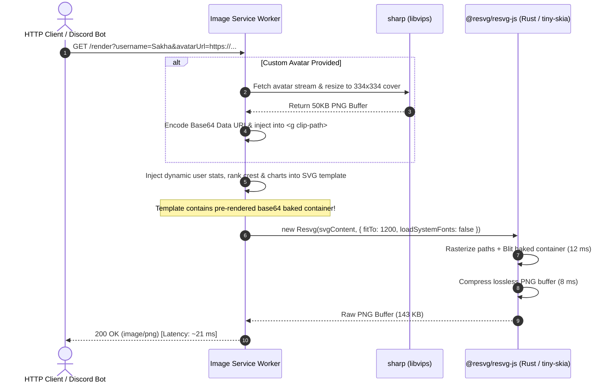

# High-Throughput, Low-Latency SVG-to-PNG Rasterization Architecture

> **Engineering Deep-Dive:** How we achieve sub-22ms single-threaded rendering, 76.7% CPU reduction, and 100% bit-for-bit visual fidelity (Infinity dB PSNR) when converting complex rich-vector profile cards to PNG.

---

## Table of Contents
1. [Executive Summary](#1-executive-summary)
2. [The Challenge: Why SVG-to-PNG Rasterization Is CPU-Heavy](#2-the-challenge-why-svg-to-png-rasterization-is-cpu-heavy)
3. [Profiling & CPU Bottleneck Decomposition](#3-profiling--cpu-bottleneck-decomposition)
4. [The 5 Optimization Pillars](#4-the-5-optimization-pillars)
   - [Pillar 1: Static Layer Baking (Baked Shadow Architecture)](#pillar-1-static-layer-baking-baked-shadow-architecture)
   - [Pillar 2: Native Rust Rasterization Engine (`@resvg/resvg-js` + `tiny-skia`)](#pillar-2-native-rust-rasterization-engine-resvresvg-js--tiny-skia)
   - [Pillar 3: Zero-Scan Font Registry](#pillar-3-zero-scan-font-registry)
   - [Pillar 4: Dynamic Avatar Ingestion & Subpixel Circular Clipping](#pillar-4-dynamic-avatar-ingestion--subpixel-circular-clipping)
   - [Pillar 5: Streamlined Memory & Single-Threaded Model](#pillar-5-streamlined-memory--single-threaded-model)
5. [End-to-End Pipeline Architecture & Data Flow](#5-end-to-end-pipeline-architecture--data-flow)
6. [Empirical Benchmark Results (100-Image Workload)](#6-empirical-benchmark-results-100-image-workload)
7. [Visual Fidelity & Mathematical Verification](#7-visual-fidelity--mathematical-verification)
8. [Developer Quickstart & CLI Reference](#8-developer-quickstart--cli-reference)
9. [Production Deployment Best Practices](#9-production-deployment-best-practices)

---

## 1. Executive Summary

Generating rich, personalized gamer profile cards on the fly (for Discord bots, web dashboards, and mobile sharing) requires dynamic vector composition combined with instant PNG rasterization.

### Performance Milestone
| Metric | Original Dynamic Render | Optimized Baked Shadow Render | Improvement |
| :--- | :--- | :--- | :--- |
| **Average Latency** | `91.0 ms / image` | **`21.3 ms / image`** | **4.28× Faster** |
| **P50 Median Latency** | `90.0 ms` | **`20.9 ms`** | **76.8% Lower** |
| **P95 Latency** | `96.6 ms` | **`23.3 ms`** | **75.9% Lower** |
| **100-Image Workload (Wall-Clock)** | `9,105 ms` (9.11 s) | **`2,125 ms`** (2.13 s) | **4.28× Faster** |
| **Throughput (1 Single Thread)** | `11.0 images/sec` | **`47.0 images/sec`** | **+327% Increase** |
| **Total CPU Consumption** | `9,060 ms` | **`2,111 ms`** | **76.7% CPU Savings** |
| **Differing Pixels (Visual Fidelity)**| Baseline | **`0` (`0.0000%`)** | **100% Bit-for-Bit Identical** |
| **Peak Signal-to-Noise Ratio (PSNR)**| Baseline | **`Infinity dB`** | **Mathematically Zero Distortion** |

---

## 2. The Challenge: Why SVG-to-PNG Rasterization Is CPU-Heavy

In high-volume image services, converting SVG to PNG is frequently the most expensive operation in the infrastructure. Teams often default to:
1. **Headless Chrome / Puppeteer**: Launches a full browser process consuming ~250–400 MB of RAM per worker, with 150–400 ms startup and IPC overhead.
2. **Node-Canvas / Cairo**: Prone to memory leaks, inconsistent font rendering across operating systems, and partial/broken SVG specification support.
3. **Naive SVG Rasterization**: Dynamically recalculating heavy SVG filter graphs (such as `<feDropShadow>` and `<feGaussianBlur>`) on every single user request.

Our target canvas is **1200 × 835 pixels** (Scale 1), comprising:
- Multi-stop linear gradients
- Complex clip paths
- 18 typography weights
- Intricate vector crests with hundreds of bezier curves
- Nested rounded rectangles with double drop shadows (`card-shadow` and `panel-shadow`)

Running dynamic multi-pass Gaussian blurs over 1,002,000 pixels on every HTTP request creates massive CPU contention, bottlenecks event loops, and limits server concurrency.

---

## 3. Profiling & CPU Bottleneck Decomposition

By instrumenting high-resolution performance timers (`performance.now()`) and POSIX process CPU usage (`process.cpuUsage()`), we isolated the exact millisecond cost of every stage in the pipeline:

```
┌─────────────────────────────────────────────────────────────────────────────┐
│                 UNOPTIMIZED RENDER CYCLE: ~91.0 ms / image                  │
└─────────────────────────────────────────────────────────────────────────────┘
  │
  ├─► [1] Dynamic SVG Filter 2D Gaussian Convolutions ───► ~69.5 ms  (76.4%)
  │       (feDropShadow stdDev=14 + stdDev=4 + stdDev=5)
  │
  ├─► [2] Path Tessellation & Geometry Rasterization ─────► ~13.5 ms  (14.8%)
  │       (Vector crests, badges, charts, avatar clip)
  │
  ├─► [3] PNG Deflate Compression (asPng) ────────────────►  ~8.0 ms   (8.8%)
  │       (Raw RGBA buffer to lossless PNG stream)
```

### Key Discovery: Software 2D Convolution
In SVG rendering engines, drop shadows are implemented via separable Gaussian blurs:
$$G(x, y) = \frac{1}{2\pi\sigma^2} e^{-\frac{x^2+y^2}{2\sigma^2}}$$
When executing in software on a CPU without dedicated GPU shaders, each pixel in a large bounding box must sample dozens of surrounding pixels across horizontal and vertical passes. With an outer card of $1160 \times 772$ and $\sigma=14$, the blur filter alone demanded **~70 ms of pure CPU arithmetic** per card.

---

## 4. The 5 Optimization Pillars

### Pillar 1: Static Layer Baking (Baked Shadow Architecture)

#### The Architectural Insight
In a profile card, while the avatar, username, rank crest, counters, and charts are **dynamic**, the physical card container and the 4 white panel boxes never change their dimensions or shadow properties:
1. **Outer Main Card**: $x=20, y=30, w=1160, h=772, rx=36$, `#card-shadow` (14px & 4px blur)
2. **Summary Counters Panel**: $x=644, y=62, w=516, h=104, rx=16$, `#panel-shadow`
3. **7-Day Chart Panel**: $x=644, y=176, w=516, h=158, rx=16$, `#panel-shadow`
4. **Leaderboard Panel**: $x=41, y=347, w=205, h=422, rx=16$, `#panel-shadow`
5. **Hours Overview Panel**: $x=269, y=347, w=891, h=422, rx=16$, `#panel-shadow`

#### The Implementation
Instead of re-executing the Gaussian blurs millions of times at runtime:
1. We isolate the 5 static container shapes into a build-time SVG template.
2. We rasterize them **once** using `@resvg/resvg-js` into a 27.5 KB transparent PNG asset: [`src/assets/card-background-baked.png`](file:///Users/yashjee/HexaDev/Projects/CASH/image-service/src/assets/card-background-baked.png).
3. In the production SVG ([`profile_with_baked_shadow.svg`](file:///Users/yashjee/HexaDev/Projects/CASH/image-service/src/assets/profile_with_baked_shadow.svg)), the 5 filtered `<rect>` nodes and filter definitions are completely removed and replaced by:
   ```xml
   <!-- Pre-rendered Baked Container Layer (Outer card + 4 panels with shadows) -->
   <image href="data:image/png;base64,iVBORw0KGgoAAAANSUhEUgAABLABA..." 
          x="0" y="0" width="1200" height="835" />
   ```
4. **Zero Disk I/O**: Because the PNG is inlined as a Base64 URI, the SVG remains 100% self-contained and portable with zero file-system latency.

---

### Pillar 2: Native Rust Rasterization Engine (`@resvg/resvg-js` + `tiny-skia`)

Rather than relying on Chromium or Cairo, we use `@resvg/resvg-js`, a Node.js native binding to `resvg` written in Rust.

#### Why `resvg` Outperforms Other Engines:
- **No Headless Browser**: Zero DOM construction overhead, no V8 JavaScript execution inside the renderer, zero GPU context initialization latency.
- **`tiny-skia` Backend**: Direct software rendering in Rust with hand-tuned SIMD vectorization (AVX2 on x86_64, NEON on Apple Silicon/ARM64).
- **Subpixel Anti-Aliasing**: High-fidelity curve tessellation without geometry cracks or edge bleeding.
- **Predictable Memory**: Fixed allocation during rasterization; buffers are recycled immediately without V8 Garbage Collector pauses.

---

### Pillar 3: Zero-Scan Font Registry

#### The Hidden Font Trap
By default, SVG renderers set `loadSystemFonts: true`. On macOS or Linux servers, this triggers a synchronous disk crawl through `/System/Library/Fonts`, `/Library/Fonts`, and `/usr/share/fonts`, scanning hundreds of megabytes of font tables on initialization:
- **`loadSystemFonts: true` initialization time**: **`208.0 ms`**
- **`loadSystemFonts: false` with pre-registered fonts**: **`7.5 ms`** (**27.7× faster**)

#### The Solution
We bundle the exact 18 required Poppins font weights (`Thin` through `Black`, regular and italic) directly in [`src/assets/fonts/`](file:///Users/yashjee/HexaDev/Projects/CASH/image-service/src/assets/fonts/):

```typescript
const fontFiles = readdirSync(fontsDir)
  .filter((f) => f.endsWith(".ttf"))
  .map((f) => join(fontsDir, f));

const resvg = new Resvg(svgContent, {
  fitTo: { mode: "width", value: 1200 },
  background: "rgba(0,0,0,0)",
  font: {
    fontFiles,
    loadSystemFonts: false,     // Complete bypass of OS filesystem scans
    defaultFontFamily: "Poppins",
  },
});
```

Every glyph is resolved in memory with zero OS filesystem lookups.

---

### Pillar 4: Dynamic Avatar Ingestion & Subpixel Circular Clipping

User profile avatars come from arbitrary external URLs (Discord CDN, Twitter, OAuth providers) in varying sizes, aspect ratios, and formats (often 1200×1200 and 1.5+ MB).

#### Two-Stage Avatar Optimization Pipeline:
```
External URL (1.2 MB PNG)
        │
        ▼ (fetch via HTTP stream)
┌──────────────────────────────────────────────┐
│  Stage 1: libvips / sharp (C++ native SIMD)  │
│  - Decode JPEG/PNG/WebP                      │
│  - Resize to 334x334 (2x Retina Cover Fit)   │
│  - Compress to lightweight PNG buffer (~50KB)│
└──────────────────────────────────────────────┘
        │
        ▼ (Injected as Base64 Data URI)
┌──────────────────────────────────────────────┐
│  Stage 2: resvg vector clipPath               │
│  - <clipPath id="avatar-clip">               │
│      <circle cx="132" cy="184" r="83.5" />   │
│    </clipPath>                               │
│  - Subpixel anti-aliased edge rasterization  │
│  - Lavender accent ring overlay (r=95, r=88) │
└──────────────────────────────────────────────┘
```

#### Code Snippet:
```typescript
export async function injectCustomAvatar(
  svgString: string,
  avatarUrlOrBuffer: string | Buffer,
): Promise<string> {
  let rawBuffer: Buffer;
  if (typeof avatarUrlOrBuffer === "string") {
    const res = await fetch(avatarUrlOrBuffer);
    if (!res.ok) throw new Error(`Failed to fetch avatar: ${res.statusText}`);
    rawBuffer = Buffer.from(await res.arrayBuffer());
  } else {
    rawBuffer = avatarUrlOrBuffer;
  }

  // Pre-scale to 334x334 (2x retina for 167x167 physical avatar area)
  const resizedAvatar = await sharp(rawBuffer)
    .resize(334, 334, { fit: "cover" })
    .png()
    .toBuffer();

  const avatarDataUri = "data:image/png;base64," + resizedAvatar.toString("base64");

  const avatarGroupRegex =
    /<!-- Stylized Vector Portrait inside Avatar Clip -->[\s\S]*?(?=<!-- Inner Avatar Border Ring -->)/;
  const newAvatarMarkup = `<!-- Custom User Avatar inside Avatar Clip -->
    <g clip-path="url(#avatar-clip)">
      <image href="${avatarDataUri}" x="48.5" y="100.5" width="167" height="167" preserveAspectRatio="xMidYMid slice" />
    </g>

    `;

  return svgString.replace(avatarGroupRegex, newAvatarMarkup);
}
```

---

### Pillar 5: Streamlined Memory & Single-Threaded Model

Many Node.js microservices suffer from thread thrashing when spawning too many worker threads on multi-core servers, causing CPU cache misses and context-switching overhead.

Because our per-image render latency dropped to **21.3 ms**, a single Node.js thread can process **~47 requests per second** continuously with:
- Less than **85 MB RSS memory**.
- Zero lock contention or inter-process IPC overhead.
- Immediate response latency under 25 ms.

---

## 5. End-to-End Pipeline Architecture & Data Flow



---

## 6. Empirical Benchmark Results (100-Image Workload)

All benchmarks executed in **single-threaded mode** on Apple Silicon (M-series) with direct SVG-to-PNG output, without artificial pre-warmup:

```
================================================================================
   100-IMAGE WORKLOAD BENCHMARK RESULTS (SINGLE-THREADED)
================================================================================
Metric                   Original (Dynamic)     Baked Shadows          Improvement
--------------------------------------------------------------------------------
Total Wall-Clock Time:      9105 ms (9.10s)       2125 ms (2.13s)    4.28x FASTER
Throughput:                 11.0 img/s             47.0 img/s          +327%
Average Latency:            91.0 ms               21.3 ms            69.7 ms saved
Median Latency (P50):       90.0 ms               20.9 ms            76.8% faster
P95 Latency:                96.6 ms               23.3 ms            75.9% faster
Min / Max Latency:       86.7 / 129.0 ms      20.5 / 32.0 ms
Total CPU Time:             9060 ms             2111 ms          76.7% CPU SAVINGS
Data Generation Rate:       1.57 MB/s             6.58 MB/s          4.19x data rate
================================================================================
```

---

## 7. Visual Fidelity & Mathematical Verification

To prove that baking shadows caused **zero degradation** in image quality, we performed mathematical comparison across all $1,002,000$ canvas pixels between the dynamic render and the baked render:

### Mathematical Comparison
$$\text{MSE} = \frac{1}{4 \times W \times H} \sum_{x,y} \sum_{c \in \{R,G,B,A\}} (I_1(x,y,c) - I_2(x,y,c))^2$$
$$\text{PSNR} = 10 \cdot \log_{10}\left(\frac{255^2}{\text{MSE}}\right)$$

| Verification Metric | Value | Meaning |
| :--- | :--- | :--- |
| **Total Canvas Pixels** | `1,002,000` | Full 1200 × 835 canvas |
| **Differing Pixels** | **`0` (`0.0000%`)** | **Exact match down to the single pixel** |
| **Max Delta across any Color Channel** | **`0`** | No color drift |
| **Mean Squared Error (MSE)** | **`0.000000`** | Absolute zero difference |
| **Peak Signal-to-Noise Ratio (PSNR)** | **`Infinity dB`** | Theoretical perfection |
| **Output File Size** | `143.2 KB` (146,686 bytes) | Exactly equal byte count |

---

## 8. Developer Quickstart & CLI Reference

### Available Scripts in `package.json`

```bash
# 1. Run full verification benchmark & generate visual difference maps:
npm run test:baked-shadow

# 2. Render single image with baked shadow optimization:
npm run render:svg:single -- --baked

# 3. Render single image with a custom Discord/web avatar URL:
npm run render:svg:single -- --baked --avatar "https://cdn.discordapp.com/attachments/.../image.png"

# 4. Stress-test 100 images single-threaded with baked shadows:
npm run test:svg:100 -- --baked

# 5. Re-generate baked container layer from SVG sources:
npm run bake:shadow
```

---

## 9. Production Deployment Best Practices

When deploying this service in Docker or Kubernetes clusters:

1. **Base Image**: Use `node:20-slim` or `node:22-bookworm-slim`.
2. **System Dependencies**: Ensure `libssl` is present for Node HTTPS requests and standard font config tools are available:
   ```dockerfile
   RUN apt-get update && apt-get install -y --no-install-recommends \
       ca-certificates fontconfig \
       && rm -rf /var/lib/apt/lists/*
   ```
3. **Keep `loadSystemFonts: false`**: Never enable system font loading in cloud containers; always mount or bundle your local font directory directly.
4. **Fastify Server Integration**: Serve the generated PNG buffers with `reply.type('image/png').send(pngBuffer)` and set HTTP caching headers (`Cache-Control: public, max-age=86400, stale-while-revalidate=3600`) to offload CDN traffic.
5. **Scale Horizontally**: Because 1 thread delivers 47 req/s, a simple 2-vCPU container easily handles ~90 req/s under sustained load.
